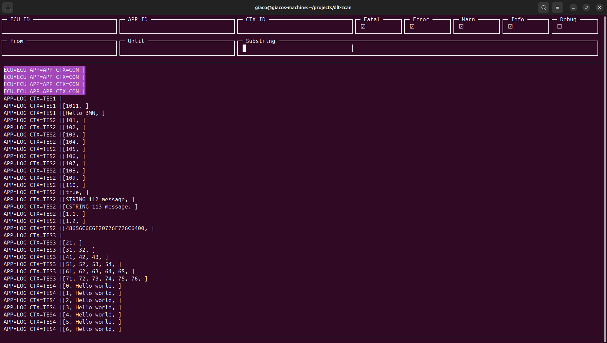

# A DLT v1 filter tool written in Zig

`dlt-zcan` is a TUI application to filter large DLT logs and output the filtered content to a new file.
`dlt-zcan` has to be compiled with zig 0.16.

> **Note:** `dlt-zcan` is currently a work in progress. It has been tested against example DLT files and large DLT logs, but full compliance with the DLT v1 specification and comprehensive test coverage are not yet guaranteed.

## Build `dlt-zcan`

To build `dlt-zcan` from source just download the repo and compile the source code to an executable:

```
zig build-exe dlt-zcan.zig -O ReleaseFast
```

## View and filter huge DLT logs

To view the logs of a dlt file, just run

```
./dlt-zcan input.dlt
```



Filters can be selected by typing:
* Ctrl+E = ECU ID
* Ctrl+A = APP ID
* Ctrl+K = Context ID
* Ctrl+S = Substring
* Ctrl+F = From
* Ctrl+U = Until

Log Levels can be toggled by typing:
* Alt+F = Fatal
* Alt+E = Error
* Alt+W = Warn
* Alt+I = Info
* Alt+D = Debug
